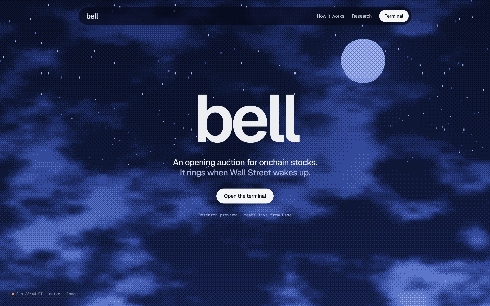
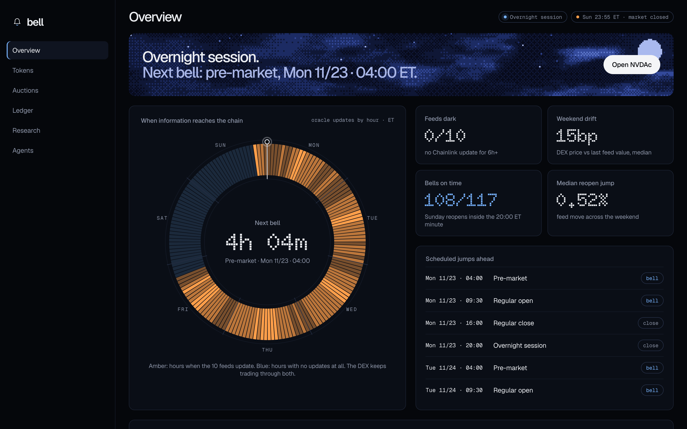
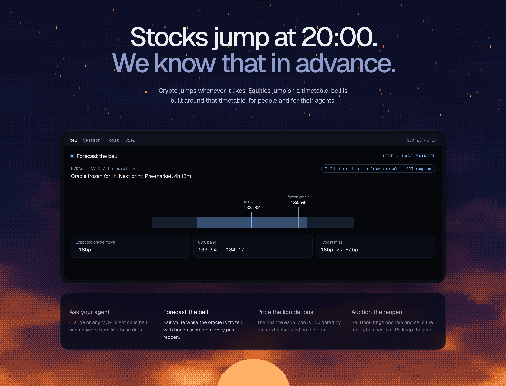
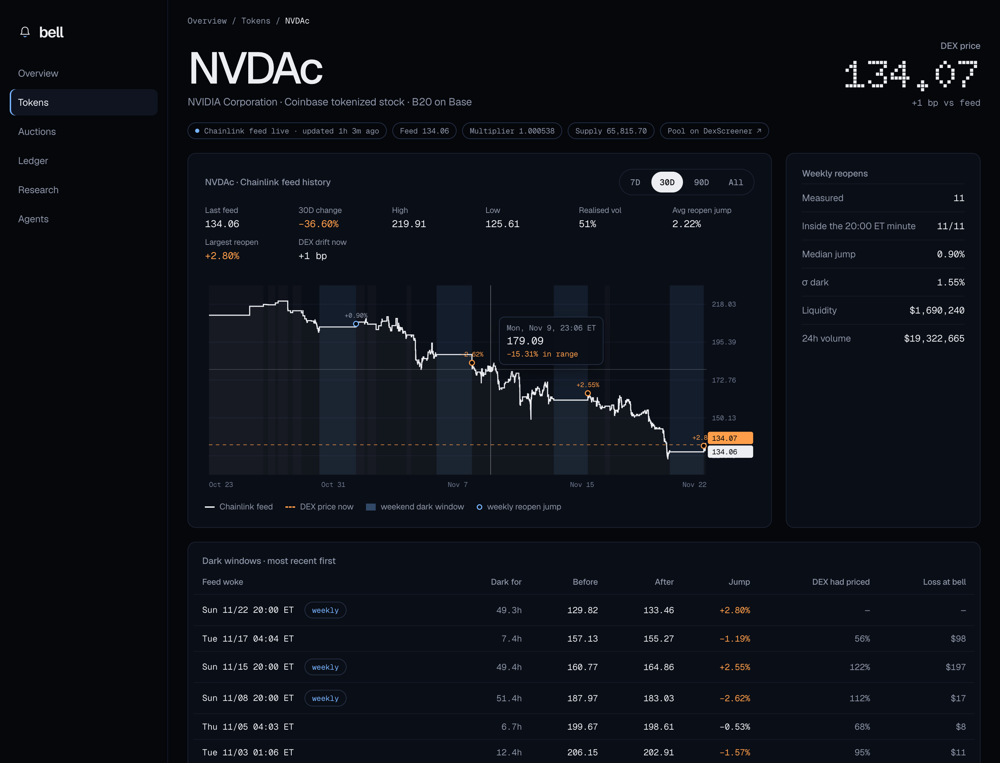
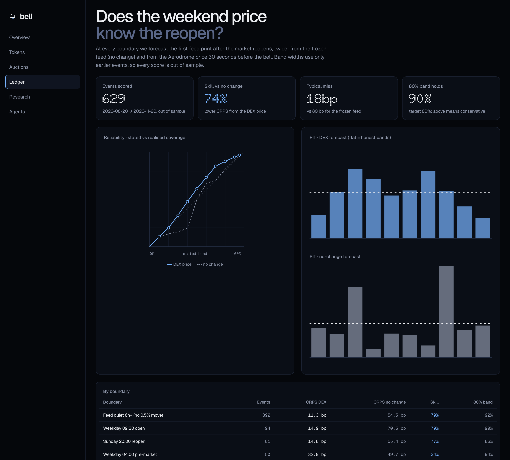
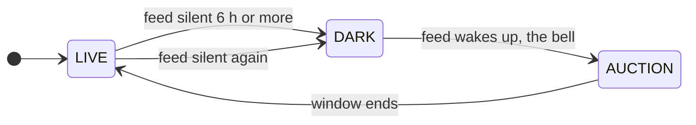
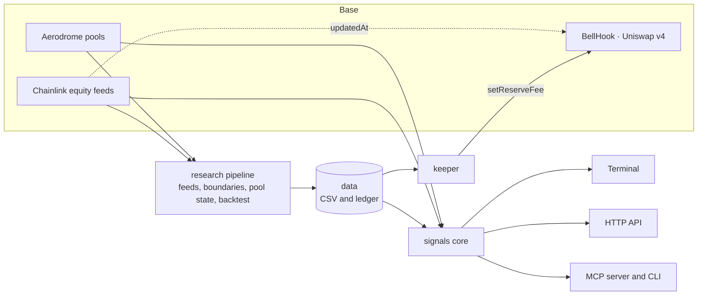

<div align="center">



<br>
<br>

# bell

### An opening auction for onchain stocks.
**It rings when Wall Street wakes up.**

<br>


**[Live terminal](https://bell.embarko.app)** · [Paper](docs/paper.md) · [The finding](#the-finding) · [Forward test](#forward-test) · [Screens](#screens) · [BellHook](#bellhook) · [For agents](#for-agents) · [Architecture](#architecture) · [Run it](#run-it) · [Honest limits](#honest-limits)

</div>

<br>

Tokenized stocks on Base trade around the clock. The prices they track do not. For about **52 hours every weekend**,
and again every night, the Chainlink feeds behind them stand still while the tokens keep trading, loans stay open and
liquidity providers keep quoting a market that has no price.

Then the feed wakes up and the whole gap lands at once.

**bell** measures that moment, forecasts it from the closed-market DEX price, and ships it three ways: a terminal for
people, an MCP server, CLI and HTTP API for agents, and a Uniswap v4 hook that auctions the reopen back to LPs instead of
handing it to the fastest bot.

> Built for Base's **Stocks Maxxing** season, *Programmable Stock Markets* track. Read-only analytics. bell never
> trades, never holds funds and is not available to US persons.

<br>

## The finding

Everything below is computed from public Base data: every Chainlink round of the ten Coinbase equity feeds since August,
and the Aerodrome pools that trade them.

| | | |
|---|---|---|
| **01 · The bell is on a timetable** | **108 of 117** | weekly reopens, across 10 stocks, where the feed's first new print lands inside the **20:00 ET minute**, typically 35 s after the bell (19-57 s). The other nine came 1-24 min later, all thin names |
| **02 · The weekend price knows the reopen** | **74% better** | than the frozen oracle at forecasting the first post-bell print **from the pool price 30 s before the bell**: CRPS 15.0 bp vs 58.0 bp over **629 boundaries**, out of sample. Typical miss **18 bp vs 80 bp**. Sunday reopens alone: 77% |
| **03 · Little is left to take at the bell** | **$11.6k** | lost by LPs to arbitrage at **227 scheduled bells** (median **$11**), and 67% of it sits in the worst tenth. The pool has already moved by then |

Finding 02 contradicts published claims that weekend token prices say little about Monday. Finding 03 reframes the product:
the *forecast* keeps a pool priced through the dark hours, and the *auction* is insurance for the tail.

Context: LPs in Aero Slipstream stock pools on Base lost **169% a year before AERO rewards** over 14 Oct - 10 Nov 2026
([Bitquery](https://bitquery.io/investigations/tokenized-stocks-liquidity-pools-lp-returns)). Of 415 Coinbase tokenized stocks on Base,
**only 10 have an onchain price feed** at all.

<br>

## Screens

<table>
<tr>
<td width="50%"><br><sub><b>Overview.</b> The week clock: amber hours are when information reaches the chain, the blue ring is silence.</sub></td>
<td width="50%"><br><sub><b>Live demo.</b> Four auto-advancing tabs on live Base data: ask, forecast, liquidations, auction.</sub></td>
</tr>
<tr>
<td width="50%"><br><sub><b>Token page.</b> Crosshair, range tabs, reopen markers, dark windows, realised vol and live DEX drift.</sub></td>
<td width="50%"><br><sub><b>Ledger.</b> Reliability, PIT and per-boundary skill. Every score is out of sample.</sub></td>
</tr>
</table>

<br>

## Forward test

A backtest can be tuned after the fact, so the repo also records forecasts **before** each bell and scores them afterwards.

- `cli/src/forward.ts` writes `forward/predictions/<bell>.json` with the same numbers `bell quotes` serves, a Base block hash and a content hash. It refuses to run once any feed has printed after the bell.
- The content hash is anchored in a Base Sepolia transaction ([`forward/anchors.md`](forward/anchors.md)).
- `research/src/bell_research/forward.py` scores each stock against the first Chainlink round at or after the bell and writes `forward/results/` and `forward/summary.json`.
- [`.github/workflows/forward.yml`](.github/workflows/forward.yml) runs around every Sunday reopen and commits as the Actions bot, so the timestamps are GitHub's. The next one is **Sunday 29 Nov, 20:00 ET**.
- The terminal shows the record live on its [Forward test](https://bell.embarko.app/terminal/forward) page.

The first record is a rehearsal on the 25 Nov 09:30 ET open, and it **did not beat the frozen oracle** (CRPS 62.0 bp vs 59.1 bp, 4 of 10 prints inside the bell minute). The forecast was locked 44 minutes early, while the backtest uses the pool price 30 seconds before the bell, so the workflow now predicts 20 and 10 minutes before the bell. A handful of bells is a handful of anecdotes; the point is that the process cannot see the outcome.

<br>

## BellHook

A Uniswap v4 hook for tokenized-stock pools. It watches the pool's reference feed and moves through four phases:



| Phase | Trigger | Swap fee |
|---|---|---|
| **LIVE** | the feed is fresh | normal |
| **DARK** | the feed has been silent for `minDarkGap` | low: weekend flow is mostly uninformed and pays LPs |
| **AUCTION** | the feed's `updatedAt` advances after a dark gap, detected onchain by the hook itself | `max(reserve, priorityFee × rate)`, capped. Competing searchers bid priority fees up and the gap is paid to LPs as fees ([MEV tax](https://www.paradigm.xyz/2024/06/priority-is-all-you-need)) |

A keeper posts the forecast band as the auction's **reserve** before each scheduled bell. A broken feed falls back to the
live fee and can never brick the pool, and `poke()` cannot be used to skip the auction.

**Run the whole story in one command** (a local anvil rehearsal; the table below is its real output, decoded from the hook's own events):

```text
$ contracts/demo.sh local

      block  event phase     swap fee    priority fee   tx
          6  swap  LIVE         0.05%     0.0000 gwei   0xb1eb754c6c…
          8  swap  DARK         0.03%     0.0000 gwei   0xa0d02d4666…
         10  bell  BELL                      dark 98s   0x9e87523ec4…
         10  swap  AUCTION      1.00%     0.0010 gwei   0x9e87523ec4…
         11  swap  AUCTION      4.00%     0.0040 gwei   0xa846da8757…
         34  swap  LIVE         0.05%     0.0000 gwei   0xd50ebd9433…
```

The same script ran on **Base Sepolia**, reusing Uniswap's deployed PoolManager and test routers. Hook: [`0xBA4c45F3…`](https://sepolia.basescan.org/address/0xBA4c45F3e694868791E3560030aC9f54B3C46080). The real run, decoded from the hook's own events:

| Phase | Swap fee | Priority fee | Tx |
|---|---|---|---|
| LIVE | 0.05% | 0 | [`0x5d40d144…`](https://sepolia.basescan.org/tx/0x5d40d14439c87c11565e71db15d328464beb030fdbd0f1ce72dfbb3b9613c6a7) |
| DARK (feed silent) | 0.03% | 0 | [`0xb4ddbecd…`](https://sepolia.basescan.org/tx/0xb4ddbecd7283b0b52784e7440f80d8a4cfdff4cb7c94ca62d125ae1ad4299c47) |
| **Bell**, then AUCTION (searcher A) | 1.00% | 0.001 gwei | [`0xbad96395…`](https://sepolia.basescan.org/tx/0xbad96395757171faa1d42904bbadf7324cd41c2d657ac070b8b32aa16094314d) |
| AUCTION (searcher B outbids) | 4.00% | 0.004 gwei | [`0xeb4ab1da…`](https://sepolia.basescan.org/tx/0xeb4ab1da6095fe53bfe1fbdec49aba43b6eec59f1bb46ae09ad0eb77184f3955) |
| LIVE again | 0.05% | 0 | [`0x8facb3e4…`](https://sepolia.basescan.org/tx/0x8facb3e45da5f4a448298a39e6a88f903c1fa96e95238c06f2e1bd274036e6f0) |

The bell fired after 199 s of feed silence. It uses a mock equity feed and mock tokens, so the fees and the phase machine are real but the prices are not. Reproduce it with `ACCOUNT=<keystore> contracts/demo.sh sepolia`.

<br>

## For agents

> **The oracle for when the oracle is closed.** What an agent needs while the price feed is frozen: fair value with
> calibrated bands, when the oracle will move and by how much, and who gets liquidated when it does.

One core ([`signals.ts`](terminal/src/lib/signals.ts)), three ways in. All of it is read-only and descriptive; agents act with their own wallets.

| Tool | Answers |
|---|---|
| `session` | market state and the next scheduled oracle bells |
| `quotes` / `quote` | frozen oracle vs live DEX price, fair value with 80/95% bands, expected move at the next bell, the model's track record |
| `risk` | the oracle's move range at the next print, and the collateral haircut that covers it |
| `pretrade` | pool fee and price impact from live pool state, plus oracle context around the trade |
| `liquidations` | the probability each lending position is liquidated by the next scheduled print |
| `history` / `calibration` | past reopens, and out-of-sample scores |

<table>
<tr>
<td width="50%" valign="top">

**MCP** (Claude, agent frameworks, any MCP client)

```json
{
  "mcpServers": {
    "bell": {
      "command": "npx",
      "args": ["tsx", "/path/to/bell/cli/src/bell.ts", "mcp"]
    }
  }
}
```

**HTTP**

```bash
curl "http://localhost:3000/api/v1/quote?symbol=NVDAc"
curl "http://localhost:3000/api/v1/risk?symbol=MSTRc&confidence=0.99"
```

</td>
<td width="50%" valign="top">

**CLI** (add `--json` for scripts)

```text
$ pnpm --dir cli bell quotes
Market closed · weekend · next bell: Weekly reopen in 8h16m

SYMBOL    ORACLE   AGE     DEX  EXP MOVE  ±80%  DRIFT
AAPLc     345.30 41h31m 349.63   +126bp  35bp   5.8×
MSFTc     489.20 40h32m 499.22   +205bp  35bp   4.5×
GOOGLc    269.72 43h01m 274.85   +190bp  35bp   4.5×
TSLAc     350.45 41h59m 358.60   +233bp  35bp   4.1×
MSTRc      79.37 40h35m  83.29   +494bp  35bp   2.2×
```

<sub>Example captured on Sunday 22 Nov, before that night's reopen.</sub>

</td>
</tr>
</table>

<br>

## Architecture



```text
research/    Python (uv). Pulls every feed round, finds boundaries, reads pool state around each bell, backtests forecasts
contracts/   Foundry. BellHook.sol, 21 tests incl. fuzzing, CREATE2 deploy script, end-to-end demo (demo.sh)
keeper/      TypeScript (viem). Posts the forecast band as the auction reserve. Dry run by default
cli/         the `bell` CLI and MCP server
terminal/    Next.js 15. Landing, overview, tokens, auctions, ledger, research, agents, and the /api/v1 HTTP API
forward/     pre-registered forecasts and their scores
docs/        screenshots and the research note
```

<br>

## Run it

**Terminal** (live Base data, no keys needed)

```bash
cd terminal && pnpm install && pnpm dev        # http://localhost:3000
pnpm --dir cli install                         # then: pnpm --dir cli bell quotes (the CLI reuses the terminal's code)
```

**Contracts**

```bash
cd contracts && ./install.sh && forge test     # dependencies are pinned, not vendored
./demo.sh local                                # needs: anvil --silent &
```

**Research pipeline** (the committed data is a snapshot; re-run to refresh it)

```bash
cd research && uv sync
uv run python -m bell_research.feeds --update           # append new feed rounds (public RPC works)
uv run python -m bell_research.boundaries
uv run --env-file .env python -m bell_research.jumps    # needs BASE_ARCHIVE_RPC_URL in research/.env
uv run python -m bell_research.forecast
cd ../terminal && pnpm sync-data                        # ship the fresh data with the app
```

Secrets stay out of git: `research/.env` and every `*.env` are ignored. Never commit an RPC key or a private key.

<br>

## Honest limits

- Feeds update on a 0.5% move or a 24 h heartbeat, so the first print after a bell can trail the true open.
- The loss measure uses pre-bell active liquidity and ignores the pool fee, which slightly overstates small events.
- Three months of history. Weekday 20:00 overnight opens have only 12 events and the DEX price does not beat the frozen oracle there.
- Forecast bands are conservative: 90% realised coverage against an 80% target.
- The backtest runs through 20 Nov. The feed history extends to the 22 Nov reopen. Re-run the pipeline to extend both.
- The terminal is read-only. The hook targets testnets and has not been audited.

<br>

## References

Milionis, Moallemi, Roughgarden & Zhang, *Automated Market Making and Loss-Versus-Rebalancing* (2022) · Bundi, *Optimal Block Time for AMM
Liquidity Providers under Jump-Diffusion Prices*, arXiv:2608.30321 · Robinson & White, *Priority Is All You Need* (2024) · Seo et al.,
arXiv:2608.09188 · Cha et al. (NEST), arXiv:2610.21491 · Amini & Feinstein, arXiv:2609.33799 · Gneiting & Raftery, *Strictly Proper Scoring Rules* (2007)

<div align="center">
<br>

<sub>Research prototype. Not an offer of any security and not investment advice. Tokenized stocks are not available to US persons.<br>
Base, Chainlink, Aerodrome and Uniswap belong to their makers; bell is independent.</sub>

</div>
